# Open Unified Ledger

**An open, working implementation of the BIS unified-ledger settlement model: tokenized
central bank money and bank deposits settling atomically.**

Built on [Hyperledger Besu](#built-on) (QBFT) · [Paladin](#built-on) ·
[OpenZeppelin Contracts](#built-on) · [ISO 20022](#built-on) · Apache-2.0

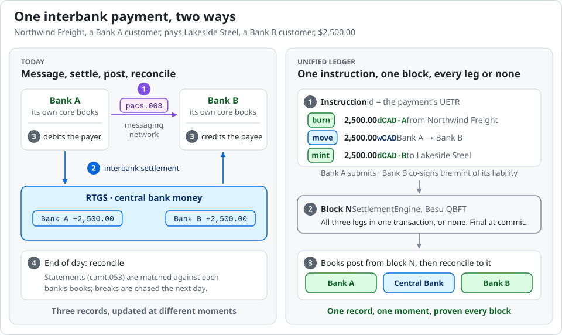

*One interbank payment, today and on a unified ledger.*

## The problem

Today an interbank payment is three events: the payer's bank sends a
message, the banks settle in central bank money in the RTGS, and each bank
then posts its own customer. Between them sit the posting lag, the
statements each side reconciles against its own books (nostro and vostro
accounts, across borders) and the breaks that reconciliation finds. In
foreign exchange, one currency can be paid before the other is received:
Herstatt risk. In securities, delivery versus payment depends on the
securities settlement system and the payment system agreeing.

## What this is

Open Unified Ledger implements the settlement model the Bank for
International Settlements (BIS) calls a unified ledger. Tokenized central
bank money and tokenized bank deposits sit on one shared ledger, and an
interbank payment, a bond trade, a cross-currency payment or a repo settles
all its legs in one instruction, or none of them. Each bank keeps its own
double-entry books beside the ledger and proves, block by block, that they
equal what the ledger holds.

It is built only from public documents (the BIS's Project Agorá report, the
Bank of Canada's Project Samara and the other sources in
[docs/sources.md](docs/sources.md)). Its participants are fictional, and
every figure on this page comes from a run anyone can repeat.

**What it does not change.** Legal finality still comes from law and a
designated system. A bank still needs central bank money on the ledger
before it pays. Operating hours, governance, loss allocation and default are
rules, not code ([rulebook §16](docs/rulebook.md#16-what-a-real-system-would-add)).

## At a glance

From runs on 19 October 2026, each given under [Results](#results) with the
command that repeats it:

- **`pnpm demo all`**: four scenarios, 52 steps and 253 ISO 20022 messages,
  every one valid against the official XSDs ([the demo](#the-demo)).
- **Two ledgers**: three coordinators, each under four faults and with
  none, on two Besu networks: 15 cases in one currency and 15 across two,
  each ending as predicted. Only the unified coordinator never leaves the ledgers
  disagreeing ([two ledgers](#two-ledgers)).
- **Confidential mode**: validators and the central bank see the wholesale
  amount and nothing of the customers ([who sees what](#who-sees-what)).
- **Conformance kit**: the real engine passes, and each of seven
  deliberately broken engines is caught on the check named for it
  ([conformance](#conformance-kit)).
- **Seeds on this release's code**, in progress: `ca-interbank` 97 of 100
  held on the first run and the three that failed under machine load held
  on rerun; `ca-bond-dvp` 13 of 13 so far ([seeds](#seeds)).
- **338 tests and 116 Foundry tests** pass ([tests](#tests)).

## Problem by problem

| The problem today | What this implementation does | Shown by |
| --- | --- | --- |
| **Settlement and posting are separate events.** The RTGS settles; each bank posts its customer later, and the gap is reconciled at day's end. | The payer's deposit, the interbank movement in central bank money and the payee's deposit move in one transaction. Each bank posts its entry with the block that settled it, and its reconciler proves after every block that its books equal the ledger. | Every `pnpm demo` run: a deliberately false entry in a bank's journal is caught as a break at the next block ([walkthrough §7](docs/walkthrough.md#7-the-audit-log)). |
| **Messages and settlement are matched after the fact.** | The `pacs`, `camt` and `sese` messages are written from the settled instruction and the bank's own journal, carry the instruction's UETR, and validate against the official XSDs. | 253 messages in one `pnpm demo all` run, every one valid ([Results](#the-demo)). |
| **Principal risk in exchanges of value.** One leg of a securities trade or an FX deal settles and the other does not; in FX, Herstatt risk. | Delivery versus payment for bonds, and payment versus payment across two currencies at a dealer's signed quote: every leg in one transaction, gross and trade by trade. | The settlement engine's invariant tests, and the conformance kit, which fails an engine that settles the legs apart ([Results](#conformance-kit)). |
| **What a second ledger costs.** Money and assets on separate ledgers need a protocol to settle together. | The same payment across two ledgers, under hashed timelocks and a notary's two-phase commit, with faults injected. Across currencies, the same windows are FX settlement risk. | Each protocol ends with one ledger settled and the other not under two of the four faults; the unified ledger never does ([Results](#two-ledgers)). |
| **A shared ledger shows too much.** One bank's customers must not be visible to its competitors. | A confidential mode in which each bank's deposits are private to its own node, while the interbank payment still settles atomically. | `pnpm confidential:compare`, field by field ([Results](#who-sees-what)). |

## Whose money is on the ledger

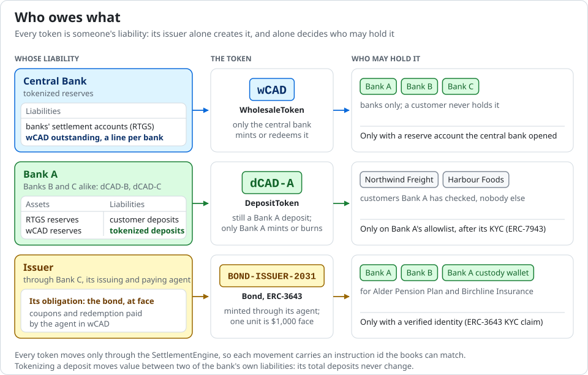

Every token is someone's liability, and only its issuer creates it and
decides who may hold it. Wholesale central bank money (`wCAD`) is the
central bank's liability, held only by banks with a reserve account. A
tokenized deposit (`dCAD-A`) is still a deposit: the issuing bank's
liability, in its books, held only by its own customers. Bonds are the
issuer's obligation, held only by verified identities. The settlement engine
moves a leg only with the approval of whoever's liability or account it
touches
([design §3.1–§3.5](docs/design.md#31-one-ledger-for-central-bank-money-and-commercial-bank-money)).

## How a payment settles

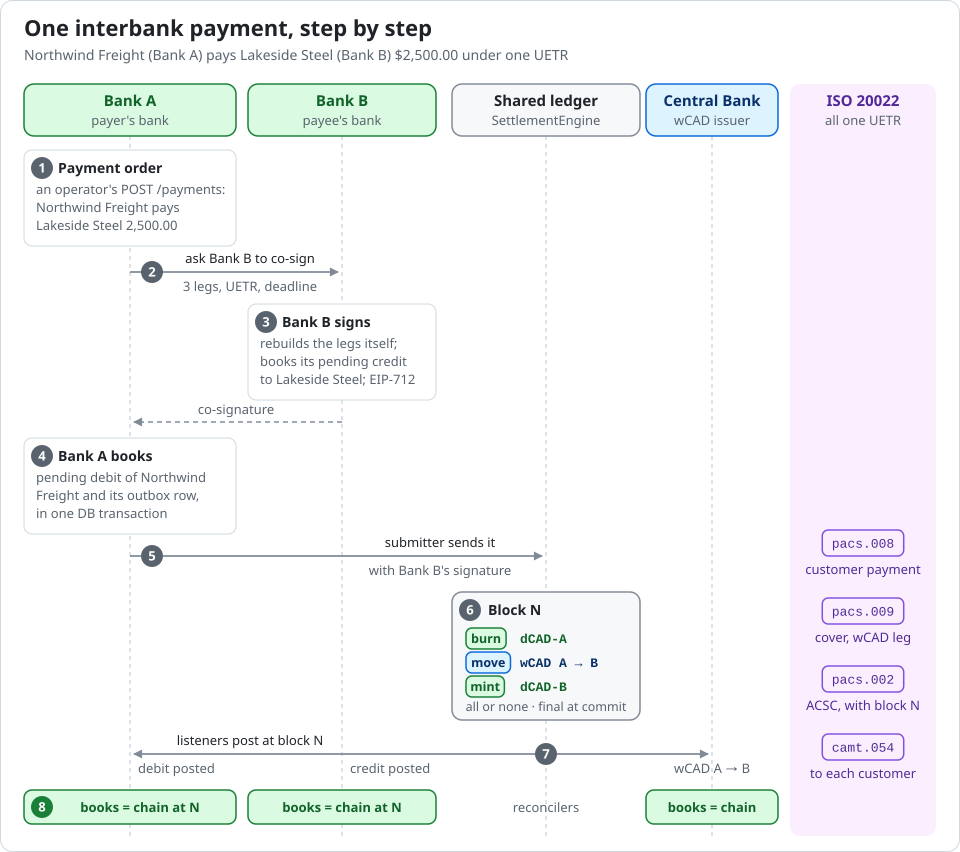

*One interbank payment in eight steps, from the operator's order to every
participant's books proven against block N.*

An operator at Bank A orders a payment of 2,500.00 CAD from its customer to
a customer of Bank B, through Bank A's API. Bank B co-signs, because the
payment creates its liability to its own customer. Bank A books the payment
as pending and sends the settlement engine one instruction of three legs:
burn Bank A's deposit token, move 2,500.00 of wholesale central bank money
from Bank A to Bank B, and mint Bank B's deposit token. In the console, from
the run the [walkthrough](docs/walkthrough.md) follows:

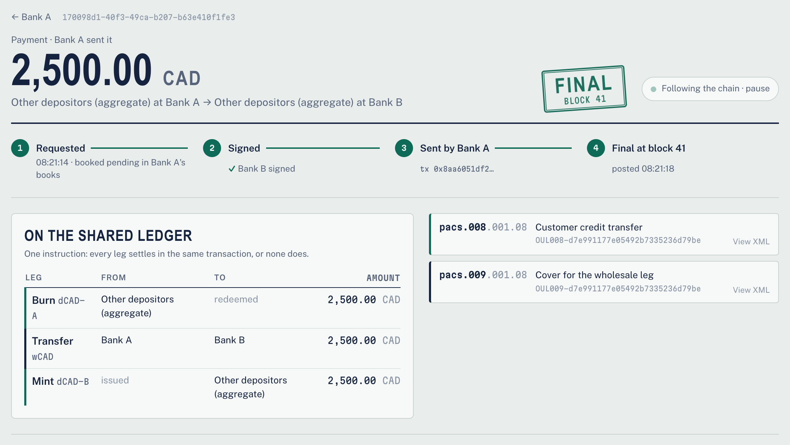

The block is final when it commits, because QBFT consensus has no forks.
Each bank posts its own entry with that block, and the messages a bank sends
today are written from it: the `pacs.008` and the `pacs.009` cover beside
the legs, a `camt.054` for the account entry and a `pacs.002` for the
outcome. ISO 20022 goes out of each bank's service; the payment comes in as
an operator's request to the bank's API.


The central bank was not a party. It signed nothing, saw the movement
between two of its account holders in a committed block, and posted it
([walkthrough §2](docs/walkthrough.md#2-an-interbank-payment)). Every
participant then proves its books against the ledger after each block it
processes:

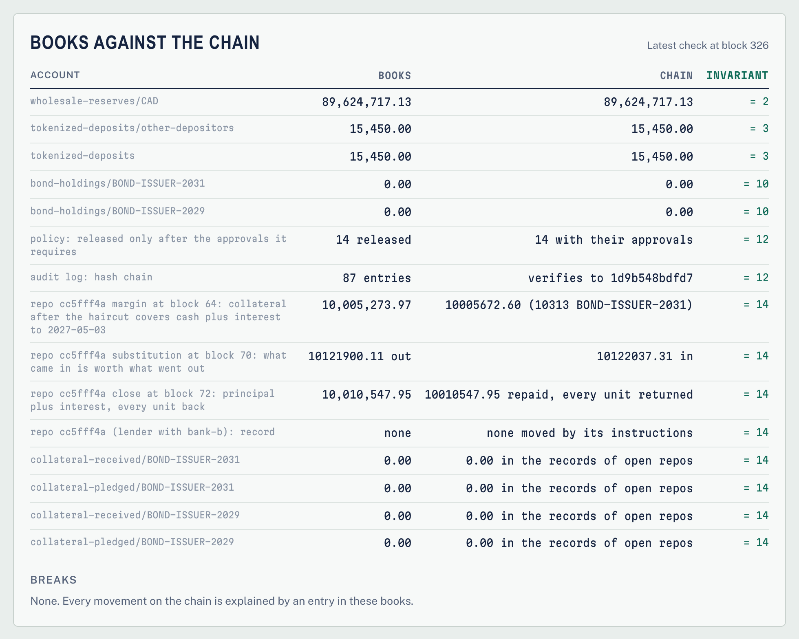

The [walkthrough](docs/walkthrough.md) follows the whole run this way, with
its terminal output: funding, a payment, an approval and a rejection, a
bond, a repo, a refusal by the engine, the audit log and the harness.

## Delivery versus payment, payment versus payment, repo

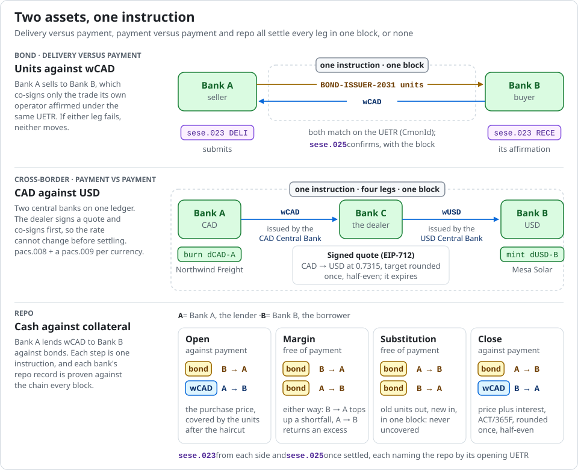

*Two assets exchanged in one instruction, so neither side's leg settles
without the other's.*

- **Bonds**, after Samara: issued against each buyer's affirmation, traded
  delivery versus payment matched on the UETR (`sese.023`, `sese.025`),
  coupons on record dates verified by every holder, and redemption. Client
  custody runs at an omnibus wallet, whose positions always equal its units
  on the ledger
  ([design §3.7](docs/design.md#37-bonds-settle-delivery-versus-payment-in-wholesale-money),
  [§3.24](docs/design.md#324-client-custody-at-an-omnibus-wallet)).
- **Payment versus payment** across CAD and USD, with two central banks on
  one ledger and a dealer bank. The payer's bank asks for a quote, the
  dealer signs it, and one instruction of four legs settles at that quote.
  Every party checks that the target amount is the source amount at the
  quoted rate, rounded once
  ([§3.17–§3.18](docs/design.md#317-several-central-banks-on-one-ledger)).
- **Repo** against tokenized bonds: opened on terms both sides affirmed,
  margin called at agreed marks, collateral substituted, and closed at
  principal plus interest (Actual/365 Fixed). A coupon paid on collateral is
  passed on to the borrower, and neither side books a sale
  ([§3.25](docs/design.md#325-repo-against-tokenized-bonds)).

## Operated like a bank

Each participant has operators with roles and an approval policy. Above the
policy's threshold a flow is booked, but it is neither signed nor sent until
an operator other than its initiator approves it. Every initiation,
approval, signature and submission goes into a hash-chained audit log, which
every participant verifies. Moving to a new signing key is one registry
change. The bond is an ERC-3643 token: a holder without a verified identity,
a direct transfer and a movement under a revoked claim are all refused, and
a lost wallet is recovered with its units
([design §3.21–§3.24](docs/design.md#321-four-eyes-before-a-signature-policies-operators-and-the-audit-log)).

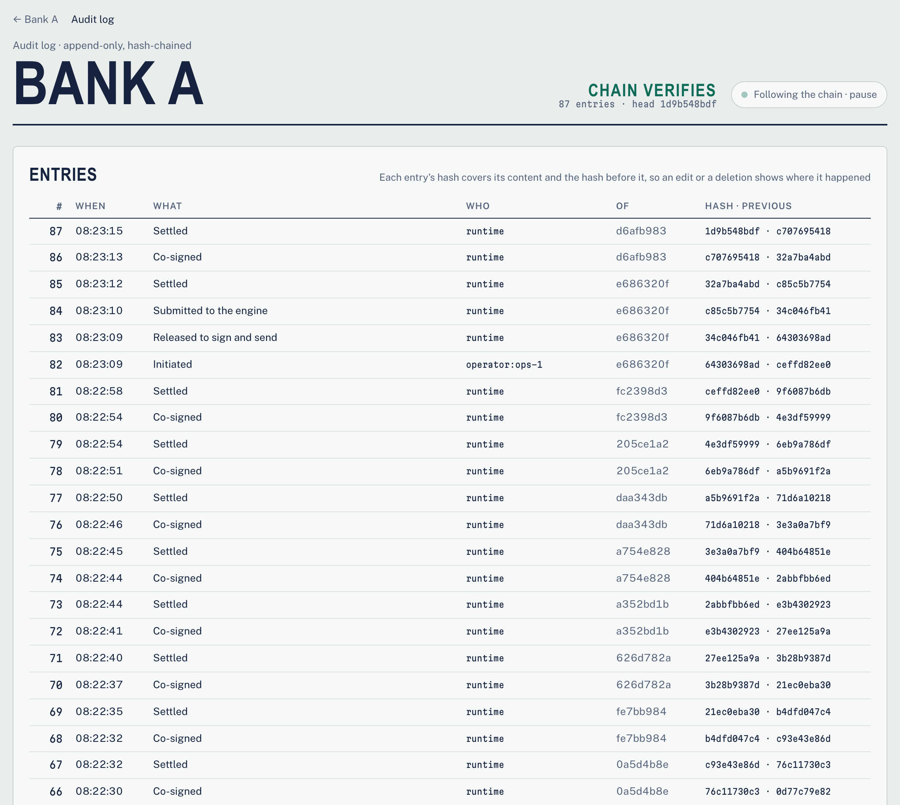

## Two ledgers instead of one

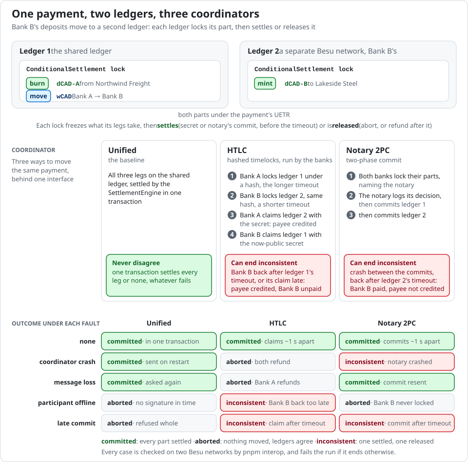

*Across two ledgers a payment can stop half-way. HTLC and notary two-phase
commit each have faults that leave the ledgers disagreeing; the unified
ledger has none.*

Interop mode puts the payee's bank on a second Besu network and moves the
same payment with three coordinators, under four faults and with none. Each case is
recorded leg by leg over time, and the console draws the window in which the
ledgers disagree
([design §3.15](docs/design.md#315-what-a-second-ledger-costs-interop-mode),
[§3.19](docs/design.md#319-across-currencies-on-two-ledgers-interop-mode)).


## Deposits private to their bank

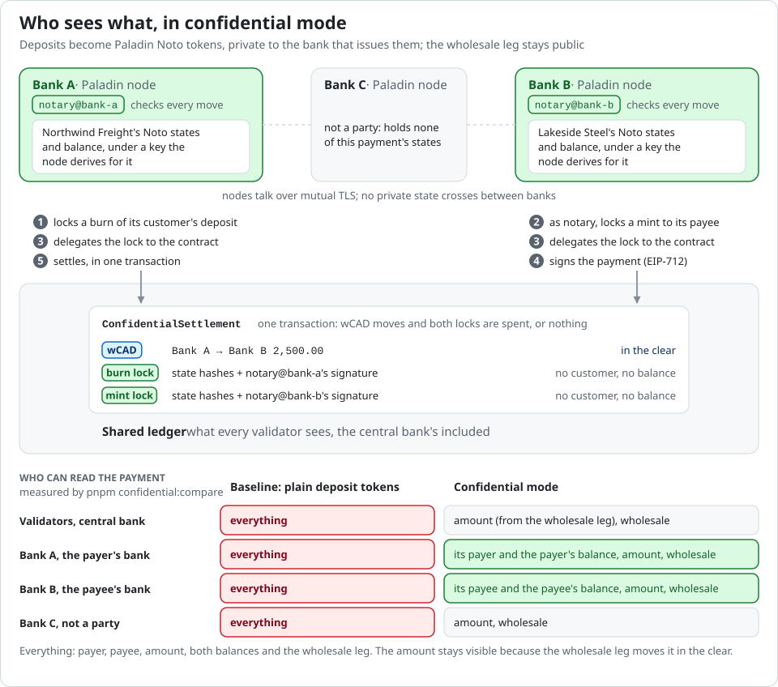

*Validators see the wholesale leg, and only hashes of the deposits.*

In confidential mode each bank runs a Paladin node and notarizes its
deposits as Noto tokens. An interbank payment locks a burn at the payer's
bank and a mint at the payee's, and one shared-ledger transaction moves the
wholesale leg and spends both locks together
([design §3.16](docs/design.md#316-deposits-private-to-their-bank-confidential-mode)).


## Any engine, checked against the same invariants

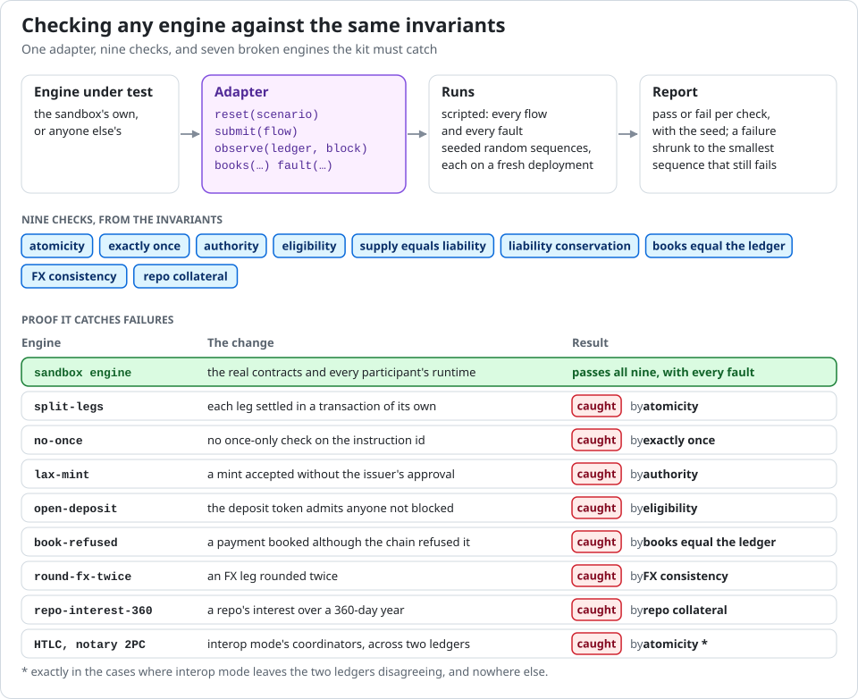

The conformance kit runs nine checks against any settlement engine through
one adapter, on scripted and seeded runs with faults: atomicity, exactly
once, authority, eligibility, supply equals liability, liability
conservation, books equal the ledger, FX consistency and repo collateral
([docs/conformance.md](docs/conformance.md)). A kit that catches nothing
proves nothing, so it ships seven broken copies of this engine, and each
must fail on the check named for it.

## Results

Each result below gives its date and the command that repeats it. The runs
on Besu used four QBFT validators (five for `ca-us-pvp`) on one Apple
silicon laptop. All ran on this release's code; since then only the
documentation, code comments and the console's display have changed.

### The demo

On 19 October 2026, on Besu:

| Command | Result |
| --- | --- |
| `pnpm demo --no-explore` | `ca-interbank`: 9 steps passed in 54 s, 28 ISO 20022 messages valid |
| `pnpm demo ca-repo` | the run the [walkthrough](docs/walkthrough.md) follows, made alongside a seed batch: 18 steps passed in 226 s, 80 messages valid; an earlier run of the same took 161 s |
| `pnpm demo all` | all four scenarios: 52 steps passed in 615 s, 253 messages valid (28, 87, 58 and 80), including regenerating the network twice, for `ca-us-pvp`'s five validators and back |

In every scenario every flow settled, every participant reconciled with the
ledger at the end, and a deliberately corrupted journal entry showed up as a
break at the next block. The 54 s run shared the machine with a seed batch
on a second instance and two conformance runs.

### Two ledgers

On 19 October 2026, on two Besu networks (`pnpm interop ca-interbank`,
52 s): a payment of 2,500.00 CAD with the payer's burn and the wholesale
move on the shared ledger and the payee's mint on a second ledger run by
Bank B, under each coordinator and each fault.

| Coordinator | No fault | Coordinator crash | Message lost | Participant offline | Late commit |
| --- | --- | --- | --- | --- | --- |
| unified | committed | committed | committed | aborted | aborted |
| HTLC | committed (1.1 s apart) | aborted | aborted | **inconsistent** | **inconsistent** |
| notary 2PC | committed (0.8 s apart) | **inconsistent** | committed (8.7 s apart) | aborted | **inconsistent** |

*Inconsistent* means the run ended with one ledger settled and the other
released: the payee was credited on ledger 2 while the payer was refunded on
ledger 1, or the reverse. The time in brackets is how long the two ledgers
disagreed before a committed case caught up. The unified coordinator settles
all three legs in one transaction, so it never opens a window. Every case
ended as SPEC.md §7 expects.

Across currencies (`pnpm interop ca-us-pvp`, 57 s, the same day): 2,500.00
CAD on the shared ledger against 1,828.75 USD on a second ledger run by the
USD Central Bank, through the dealer, Bank C. Every case ended as in the
table above. Where the ledgers ended disagreeing, one currency had been
delivered and the other not. Under the hashed timelock, the dealer paid the
USD and never received the CAD; under the notary, the dealer received the
CAD and the payee was never paid. That is Herstatt risk. The unified ledger,
with all four legs in one transaction, had no such window.

### Who sees what

On 19 October 2026, `pnpm confidential:compare ca-interbank` made the same
payment of 1,750.00 CAD in each mode on Besu, with a Paladin node per bank,
and recorded what each participant could read of it:

| Participant | Baseline | Confidential |
| --- | --- | --- |
| every validator | payer, payee, amount, both balances | amount (the wholesale leg) |
| Central Bank | payer, payee, amount, both balances | amount (the wholesale leg) |
| Bank A, the payer's bank | payer, payee, amount, both balances | payer, amount, payer's balance |
| Bank B, the payee's bank | payer, payee, amount, both balances | payee, amount, payee's balance |
| Bank C, not a party | payer, payee, amount, both balances | amount (the wholesale leg) |

The interbank amount stays visible because the wholesale leg settles in the
open on the shared ledger.

### Conformance kit

On 19 October 2026, each run on a fresh local Anvil: the scripted run (every
flow, then every fault once) and one seeded run, for the real engine and for
each broken engine the scenario can show.

```bash
pnpm conformance ca-repo --engine all --anvil --seed 41 --steps 12 --shrink 0
pnpm conformance ca-us-pvp --engine all --anvil --seed 31 --steps 12 --shrink 0
```

| Engine | What is broken | `ca-repo` (1,020 s) | `ca-us-pvp` (714 s) |
| --- | --- | --- | --- |
| sandbox | nothing: the real engine | passed every check | passed every check |
| `split-legs` | legs settled in separate transactions | caught on atomicity | caught on atomicity |
| `no-once` | no once-only check on the instruction id | caught on exactly once | caught on exactly once |
| `lax-mint` | a mint accepted without the issuer's approval | caught on authority | caught on authority |
| `open-deposit` | a deposit token open to anyone not blocked | caught on eligibility | caught on eligibility |
| `book-refused` | a payment booked when the chain refused it | caught on books equal the ledger | caught on books equal the ledger |
| `round-fx-twice` | an FX leg rounded twice | (needs two currencies) | caught on FX consistency |
| `repo-interest-360` | repo interest over a 360-day year | caught on repo collateral | (needs repo) |

Where a broken engine also failed other checks, they are exactly the ones
[docs/conformance.md](docs/conformance.md#proof-that-it-catches-failures)
lists for it. The same commands without `--anvil` run on the Besu network;
the earlier Besu runs are recorded in
[docs/conformance.md](docs/conformance.md#on-the-besu-network).

### Seeds

The simulation harness runs seeded random flows through the services with
faults mixed in (a validator stopped, a service killed mid-payment, a
participant left behind, duplicate submissions, stale signatures, a frozen
counterparty) and checks every invariant at every block, directly from the
books and the ledger. `pnpm sim:seeds <scenario> --summary` shows every
recorded seed, grouped by the commit it ran against. The records live in
`sim/runs/seeds/`, which git does not track, so the figures are stated here.

- **This release's code: in progress.** Each scenario runs seeds of 20
  steps with faults at a rate of one in four (`pnpm sim:seeds <scenario>
  --from 1 --to 1000 --steps 20 --faults 0.25`), 100 per scenario first,
  then on to 1,000. At 14:54 UTC on 19 October 2026:
  - `ca-interbank`, seeds 1 to 100: 97 held every invariant (1,256 flows
    settled, 399 faults survived, 78,908 invariant checks). Seeds 72, 85
    and 88 failed while the laptop was saturated by other runs: two RPC
    calls timed out, and in seed 85 a bank starved of CPU submitted a payment
    after its deadline, which the engine refused as the rules require
    ([rulebook 4.4](docs/rulebook.md#4-instructions)). Rerun on an idle machine, all three
    held every invariant.
  - `ca-bond-dvp`, seeds 1 to 13: all held every invariant (173 flows
    settled, 56 faults survived, 14,072 invariant checks).
  - `ca-us-pvp` and `ca-repo`: not yet started.
- **`ca-interbank`, seeds 1 to 200, on an earlier development version**, on
  18 October 2026 with the same settings: 198 held every invariant (2,567
  flows settled, 820 faults survived, 151,080 invariant checks). Seeds 72
  and 73 failed on two problems in the harness, not in the system under
  test: a restarted service given too little time to answer (60 s), and two
  processes migrating one participant's schema at once. Both are fixed in
  this release.

### Tests

On 19 October 2026:

| Command | Result |
| --- | --- |
| `pnpm test` | 338 tests in 34 files passed, in 843 s (most of it local Anvil chains at one block a second) |
| `pnpm test:contracts` | 116 Foundry tests in 17 suites passed (unit, fuzz and invariant), in 11 s |

## What it does not do

- **No legal effect.** Settlement is final when a block commits; legal
  finality would come from law and a designated system, which a sandbox does
  not have. Its rules are a [sandbox rulebook](docs/rulebook.md).
- **Not those projects.** Agorá involved seven central banks, dozens of
  commercial banks, several ledgers and legal analysis in seven
  jurisdictions; Samara a real bond. This implements settlement mechanics
  only, on one ledger, in one currency or two.
- **Not everything a market needs.** The wholesale leg is not private, the
  dealer's FX rates are fixed per direction, repo marks are agreed by both
  sides rather than taken from a market, and there is no liquidity-saving
  mechanism, master agreement, default management or authenticated link
  between participants
  ([design §4](docs/design.md#4-what-the-sandbox-leaves-open)).
- **No real money, customers or KYC.** The participants are fictional.

## How it is built

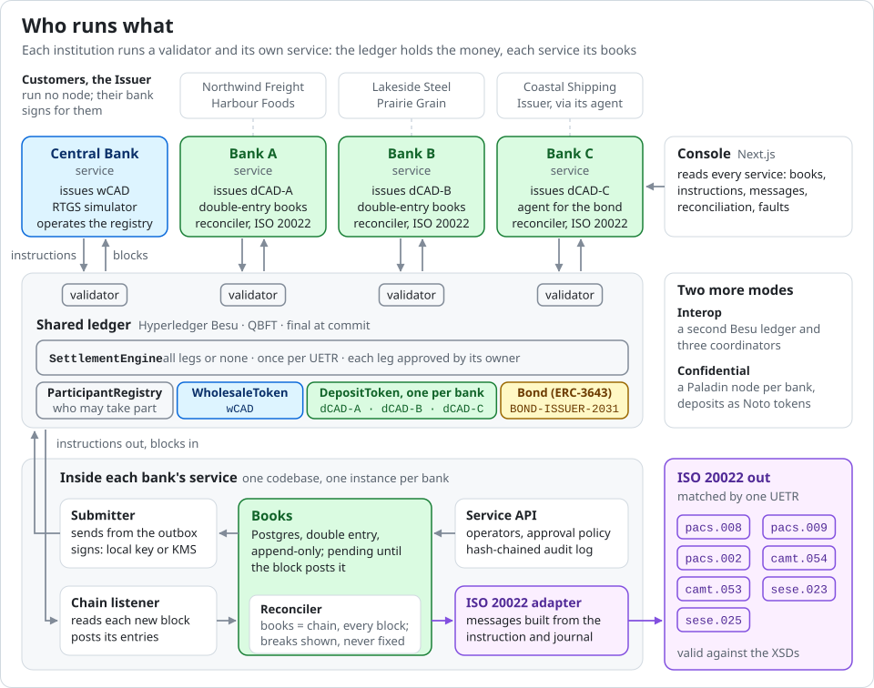

*Each institution runs a validator and its own service. The shared ledger
holds the money; each service holds its books and proves them against the
chain.*


*What runs, at the pinned versions: each institution's stack, the shared
ledger, interop mode and the tooling.*

The engine hard-codes no currency or number of banks; a scenario folder
defines them. Four scenarios ship, in Canadian dollars (with US dollars for
the cross-border one), because the public projects they follow are the
BIS's and the Bank of Canada's. In the tests, a yen fixture with four banks,
one of them without a validator, runs the same flows on the same engine.

| Scenario | What it runs |
| --- | --- |
| [`ca-interbank`](scenarios/ca-interbank/README.md) | interbank payments in one currency, after Agorá's settlement model |
| [`ca-bond-dvp`](scenarios/ca-bond-dvp/README.md) | a bond issued, traded, paid and redeemed, after Samara, with client custody |
| [`ca-us-pvp`](scenarios/ca-us-pvp/README.md) | CAD and USD, two central banks and a dealer, payment versus payment |
| [`ca-repo`](scenarios/ca-repo/README.md) | a repo between two banks against two bonds |

### Built on

| Project | Version | Role here | License |
| --- | --- | --- | --- |
| [Hyperledger Besu](https://github.com/hyperledger/besu), an LF Decentralized Trust project | 26.9.0 | the shared ledger and interop mode's second ledger, QBFT consensus | Apache-2.0 |
| [Paladin](https://github.com/LFDT-Paladin/paladin), an LF Decentralized Trust project | v1.0.0 | a node per bank in confidential mode, deposits as Noto tokens | Apache-2.0 |
| [OpenZeppelin Contracts](https://github.com/OpenZeppelin/openzeppelin-contracts) | v5.7.0 | token, access-control and EIP-712 building blocks for the contracts | MIT |
| [Foundry](https://github.com/foundry-rs/foundry), with solc | solc 0.8.37 | contract builds, unit, fuzz and invariant tests, Anvil for local chains | MIT or Apache-2.0; solc GPL-3.0, used as a compiler |
| [viem](https://github.com/wevm/viem) | 2.57 | every service's and script's access to the ledger | MIT |
| [Fastify](https://github.com/fastify/fastify) | 5.12 | each participant's HTTP API | MIT |
| [Next.js](https://github.com/vercel/next.js) | 16.4.2 | the console | MIT |
| [PostgreSQL](https://www.postgresql.org/) | 17 | each participant's books, a schema each | PostgreSQL License |
| ISO 20022 message schemas, from [iso20022.org](https://www.iso20022.org/) | `pacs.008.001.08`, `pacs.009.001.08`, `pacs.002.001.10`, `camt.053.001.08`, `camt.054.001.08`, `sese.023.001.13`, `sese.025.001.13` | validating every message the services write | the ISO 20022 Intellectual Property Right Policy ([note](packages/iso20022/schemas/README.md)) |
| Standards: ERC-7943, ERC-3643, EIP-712, ERC-734 and ERC-735 | | the cash tokens' interface; the bond, its identities and claims; signed approvals and quotes | published standards |

The ERC-3643 implementation is this project's own, written from the
published standard, because the reference T-REX and ONCHAINID code is
GPL-3.0 and this project is Apache-2.0.

## Run it yourself

<details>
<summary>Quick start, and every part on its own</summary>

Needs Node 24 or later, pnpm, Docker with about 2 GB of memory to spare
(four Besu validators of about 350 MB each, and Postgres) and
[Foundry](https://getfoundry.sh).

```bash
git clone --recurse-submodules <this repository>
cd open-unified-ledger
pnpm install
pnpm demo
```

`pnpm demo` starts Postgres and a four-validator Besu QBFT network, deploys
the `ca-interbank` scenario afresh, runs every one of its flows over the
services' HTTP APIs with their checks, and leaves the services and the
console running on http://localhost:7090 to explore. Once the network was
up, it took 54 s (`pnpm demo --no-explore` under [Results](#the-demo)); the first run also
pulls the Besu and Postgres images. `pnpm demo ca-repo` does the same for
the scenario with bonds and repo, and `pnpm demo all` runs all four
scenarios in turn (615 s, regenerating the network for the five validators
of `ca-us-pvp` and back). Ctrl-C stops the services and the console;
`pnpm network:down` stops the network.

To run the tests:

```bash
pnpm db:up
pnpm test
pnpm test:contracts
```

`pnpm db:up` starts a Postgres on port 55442 for the books; the tests create
and drop their own schemas in it. The runtime tests start their own Anvil
from Foundry, and are skipped if Anvil is not installed. In an existing
clone, fetch the Solidity libraries with `git submodule update --init`.

To run the whole system on the Besu network:

```bash
pnpm network:generate ca-interbank
pnpm network:up
pnpm e2e ca-interbank
pnpm network:down
```

`pnpm e2e` deploys the scenario if needed, starts every participant's
service as its own process and drives the scenario's flows through their
HTTP APIs. It then checks that every participant reconciles with the chain,
that every ISO 20022 message the services serve is valid against the
official XSDs, and that a deliberately corrupted entry is caught. `pnpm demo`
runs it on a fresh deployment. The validators' keys are derived from public
labels and are for the sandbox only.

The other scenarios run the same way, after `pnpm network:generate
<scenario>` (`pnpm demo <scenario>` does it for you): `ca-bond-dvp` adds a
bond's whole life (SPEC.md §5.4–§5.6), `ca-us-pvp` payments across
currencies at the dealer's quote, each way (§13), and `ca-repo` a repo's
whole life after the bond's issue and trade (§5.7–§5.10). The network's
account allowlist is the scenario's, so generate the network for the
scenario you run.

Interop mode (SPEC.md §7) adds a second, separate ledger beside the shared
one:

```bash
pnpm interop:generate ca-interbank
pnpm interop:up
pnpm run deploy ca-interbank
pnpm interop:deploy ca-interbank
pnpm interop:smoke ca-interbank
```

Then run every coordinator under every fault (`--verbose` narrates,
`--coordinator` and `--fault` pick cases):

```bash
pnpm interop ca-interbank
```

With `ca-us-pvp` instead, the second ledger carries USD and the payment
splits by currency, so the windows are FX settlement risk. The smoke run is
for one currency; across two, `pnpm interop ca-us-pvp --fault none` does
its job.

Confidential mode (SPEC.md §10) runs a Paladin node per bank beside the
shared ledger. Each validator is capped at 640 MB and each Paladin node uses
about 180 MB, so give Docker room for both:

```bash
pnpm confidential:deploy ca-interbank
pnpm confidential:up
pnpm confidential:setup ca-interbank
pnpm confidential:smoke ca-interbank
pnpm confidential:pay ca-interbank
pnpm confidential:compare ca-interbank
```

`pnpm network:smoke`, `pnpm interop:smoke`, `pnpm interop` and the
confidential commands move tokens on chain directly, behind the services,
whose books then rightly report breaks. Before running the services on that
deployment, deploy afresh:

```bash
pnpm run deploy ca-interbank -- --force
```

The simulation harness runs seeded random flows through the services,
checking every invariant at every block directly from the books and the
chain:

```bash
pnpm sim ca-interbank --seed 1 --steps 50
```

With faults, each once or mixed into a seeded run:

```bash
pnpm sim ca-interbank --script faults
```

```bash
pnpm sim ca-interbank --seed 42 --steps 40 --faults 0.25
```

To run many seeds in a batch, one after another: each result is recorded in
`sim/runs/seeds/<scenario>.jsonl` with the commit it ran against and the
command that reproduces it. A stopped batch resumes where it left off, and
the summary groups results by commit:

```bash
pnpm sim:seeds ca-interbank --from 1 --to 1000
```

```bash
pnpm sim:seeds ca-interbank --summary
```

The conformance kit ([docs/conformance.md](docs/conformance.md)) runs
against this implementation's own engine: the scripted run of every flow and
every fault, then seeded runs, each on a fresh deployment. It reports every
check and shrinks a failing run to the smallest sequence that still fails.
`--engine all` also runs, after the real engine, each broken engine the
scenario can show; `--anvil` runs on a fresh local Anvil instead of the
network:

```bash
pnpm conformance ca-interbank --seeds 1..3
```

To run the services yourself and call them:

```bash
pnpm run deploy ca-interbank
pnpm services:up ca-interbank
```

Every request that starts or approves something comes from one of the
participant's operators (`scenarios/<id>/operators.yaml`), identified by a
token derived from public labels:

```bash
TOKEN=$(pnpm -s operator:token bank-a ops-1)
```

```bash
curl -s -X POST localhost:7101/wholesale/fund -H "authorization: Bearer $TOKEN" -H 'content-type: application/json' -d '{"amount":"1000000.00"}'
```

Above its policy's threshold the service answers with status `proposed`:
the flow is booked but waits, unsigned and unsent, until another operator
holding the right role approves it at `POST /proposals/<uetr>/decisions`.
The central bank listens on 7100, Bank A on 7101, Bank B on 7102; SPEC.md
§4.5 lists every route.

With the services running, the console on http://localhost:7090 shows each
participant's books, customers, reconciliation and instructions as the
chain moves:

```bash
pnpm console
```

To drive flows and faults from the console, run the harness in serve mode
instead of `pnpm services:up` (it starts the services itself), then open
the console's Harness page:

```bash
pnpm sim ca-interbank --serve
```

To run a second instance beside the first, from another checkout, set
`OUL_SLOT=1` (up to 9) for every command there. Its networks get their own
chain ids, subnets, ports and Compose projects, and its services listen from
7200 instead of 7100. Postgres is shared; each deployment's books have
schemas of their own.

</details>

## Read further

| Document | What is in it |
| --- | --- |
| [docs/walkthrough.md](docs/walkthrough.md) | one recorded `pnpm demo ca-repo` run, through the console, with its terminal output |
| [docs/design.md](docs/design.md) | each design choice, the public source it follows, where it departs, and the test that proves it |
| [docs/rulebook.md](docs/rulebook.md) | the sandbox's participation, settlement and finality rules |
| [docs/conformance.md](docs/conformance.md) | each conformance check, what it proves and what an engine's adapter must report |
| [docs/sources.md](docs/sources.md) | every document cited, with its date and link |
| [SPEC.md](SPEC.md) | the specification: participants, instruments, flows, invariants, interop, ISO 20022, the harness, confidentiality, cross-border settlement, the conformance kit and custody operations |

## Scope and affiliation

A sandbox built from public documents only. It implements a settlement
model; it does not reproduce the central bank projects, which also involved
legal, policy and operational work no software can stand in for. Not
affiliated with or endorsed by the BIS, any central bank or any commercial
bank. All participants are fictional. Not for real money.

## License

Apache-2.0.
