# Walkthrough

One real run of `pnpm demo ca-repo`, followed through the console: an
interbank payment and a repo from instruction to settlement, each bank's
books and its ISO 20022 messages, two refusals, the audit log, and the
simulation harness. Nothing below is staged. The terminal output is the
run's own, with Docker's progress lines left out, and every screenshot comes
from the console on http://localhost:7090, of that run or, for the harness,
of the run after it.

`ca-repo` holds every kind of flow the sandbox settles in one currency:
funding, tokenizing, interbank payments, an approval policy, a bond's issue,
trade, coupons and redemption, and a repo opened, margined, substituted and
closed. `pnpm demo` on its own runs the same first half on `ca-interbank`.

Recorded on 19 October 2026 on one Apple silicon laptop, on a four-validator
Besu QBFT network. The run's whole terminal output is in
[walkthrough/pnpm-demo-ca-repo.txt](walkthrough/pnpm-demo-ca-repo.txt).
To reproduce:

```bash
pnpm install
pnpm network:generate ca-repo
pnpm demo ca-repo
```

The participants are fictional: a Central Bank, Banks A, B and C (Bank C is
the bonds' agent), an Issuer, and in this scenario one aggregate customer
per bank, "Other depositors".

## 1. The deployment

The demo starts Postgres and the Besu network, then deploys the scenario
afresh: the registry, the settlement engine, the wholesale token, a deposit
token per bank, and two bonds as ERC-3643 tokens with their identity
registries.

```
Open Unified Ledger demo: ca-repo

  starting Postgres and the Besu network if they are not running
  the network was generated for other validators (bank-a, bank-b, bank-c, cad-central-bank, usd-central-bank); regenerating for ca-repo
Generated a 4-validator QBFT network for ca-repo (chain 20261) in infra/besu/generated
  central-bank   validator 0xBA92335B13F90872436AF1Cd18114b965eA63E32  rpc http://127.0.0.1:58545
  bank-a         validator 0xbcA464c466F3c68DE84BBA4515A8d73fD445394B  rpc http://127.0.0.1:58547
  bank-b         validator 0x5799Fa5567D64Ac5fa97B0Daa66bd4EB3EE1AE2b  rpc http://127.0.0.1:58549
  bank-c         validator 0x3BcBc4DDe69601919B9ad7B3Df4e2Cad84CDEe94  rpc http://127.0.0.1:58551

Canadian interbank repo (ca-repo)
Waiting for the network to produce blocks...
Deploying ca-repo to chain 20261 from block 1
  ParticipantRegistry 0x2eb4e5b5f2815a33bcc63e000c6b229bda02677f (operated by central-bank)
  admitted bank-a, bank-b, bank-c
  SettlementEngine 0x221d63770f9fc47de7589a16dc40a7383b8e4641
  WholesaleToken wCAD 0x96740e0df056d44bda34e98e09c8b34a870799a8 (issuer central-bank)
  DepositToken dCAD-B 0x035c2a914cab304e4e63d5e7e7d00a88d798e504
  DepositToken dCAD-A 0x8e765b0a535e40a853e590d236120d9d97cff4e2
  DepositToken dCAD-C 0xdc1b423743e6725b82b96977e4d45654b6a97d3c
  ERC-3643: claim issuers for central-bank, bank-a, bank-b, bank-c; 3 bank identities, each with central-bank's KYC claim
  Bond BOND-ISSUER-2031 0x9c796ddbc33d834edfaaad90ea0e96ff22934aac (agent bank-c; ERC-3643 identity registry 0x9844cf3978ae7ce379f1bfe4f39a0329ce207dd2, compliance 0xab79ac3cf15cffa25e25e07d3e47df51b6f9b0d1)
  Bond BOND-ISSUER-2029 0x47c811025019c7901a19a202ae049d45397790e9 (agent bank-c; ERC-3643 identity registry 0xac40a3abc69afa8b656e6721905bc74019cace59, compliance 0xa1db2eb32947bb37fd8daa5accd71f1754b5643d)
  wired: settlement role granted, 3 reserve accounts opened, 4 customers allowlisted, 6 tokens listed
Reusing the deployment of ca-repo recorded in deployments/ca-repo.json

Open Unified Ledger end to end: ca-repo on chain 20261
Services: central-bank http://127.0.0.1:7100, bank-a http://127.0.0.1:7101, bank-b http://127.0.0.1:7102, bank-c http://127.0.0.1:7103
```

Each participant's service then runs as its own process, with its books in
its own Postgres schema. Every flow below goes through those services' HTTP
APIs, started by one of the participant's operators.


## 2. An interbank payment

The banks first move reserves into wholesale tokens (SPEC.md §5.1), and
Bank A tokenizes part of a customer's deposit (§5.2). Then Bank A's customer
pays Bank B's customer 2,500.00 CAD (§5.3):

```
5.1  bank-a, bank-b fund wholesale tokens from their RTGS accounts
  bank-a funded 1000000.00 CAD, minted by central-bank in block 34
  bank-b funded 1000000.00 CAD, minted by central-bank in block 37
  ✓ 11.6s

5.2  other-depositors tokenizes part of a deposit at bank-a
  other-depositors: deposit 2249995000.00, tokenized 5000.00 CAD (block 39)
  ✓ 2.9s

5.3  other-depositors at bank-a pays other-depositors at bank-b, then other-depositors pays part back
  other-depositors → other-depositors 2500.00 CAD: burn, wholesale move, mint in block 41
  other-depositors → other-depositors 1000.00 CAD in block 43
  other-depositors holds 3500.00, other-depositors holds 1500.00 CAD
  ✓ 7.7s
```


In the console, Bank A's view lists every instruction it took part in, each
stamped final with its block once it commits. The header shows that its
books equal the chain at the latest block and that its audit log's hash
chain verifies.

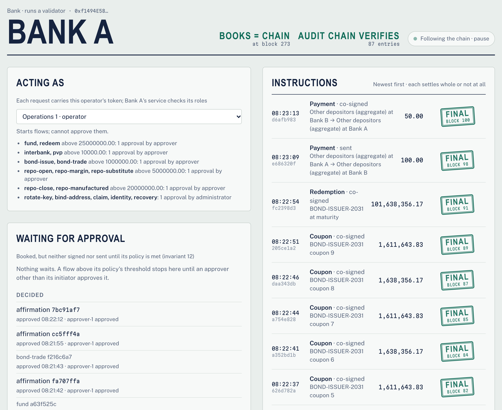

The payment opens to its timeline. Bank A asked Bank B to co-sign, because
the mint creates Bank B's liability, then sent the instruction, which was
final at block 41. Its three legs settled in that one transaction: the burn
of Bank A's deposit token, 2,500.00 of wholesale money from Bank A to Bank
B, and the mint of Bank B's deposit token.

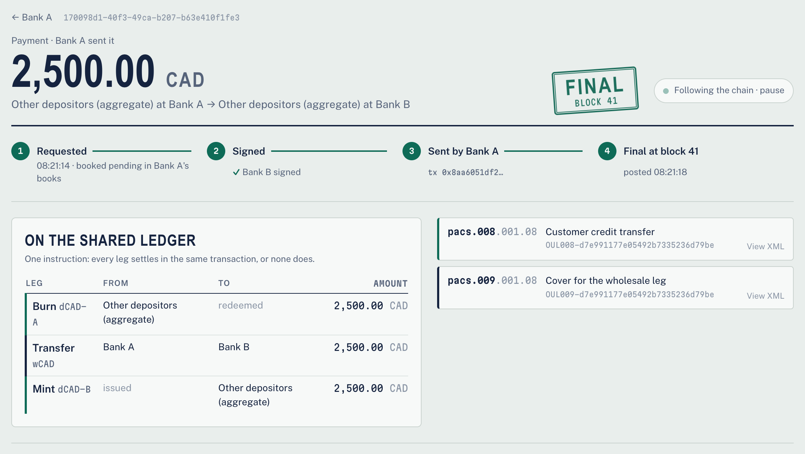

Beside the legs are the messages a bank would send for them today: the
customer credit transfer (`pacs.008`) and the cover for the wholesale leg
(`pacs.009`). Both carry the instruction's UETR, the identifier the
settlement engine settled under, so each message matches its settlement.

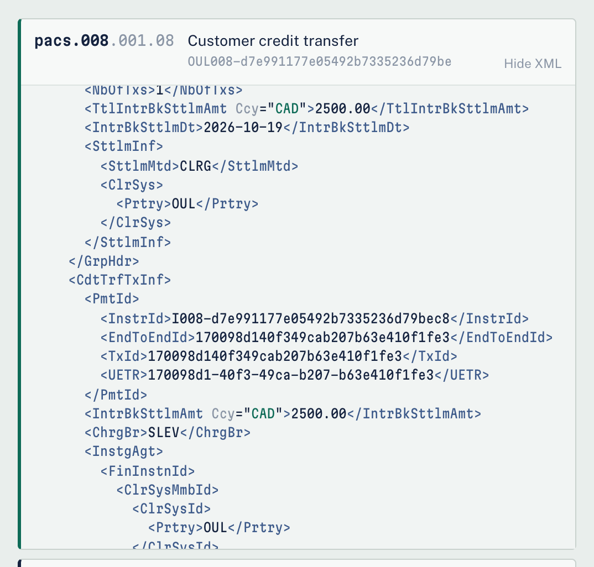

Below them is Bank A's own journal entry for the payment, posted with block
41: its tokenized deposits and its wholesale reserves each down by
2,500.00. The `camt.054` reports the debit to the account holder, and the
`pacs.002` reports the outcome.

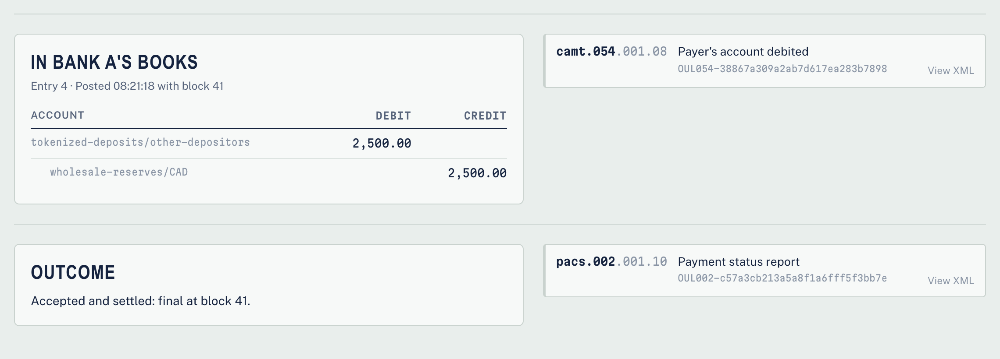

The Central Bank was not a party to the payment and signed nothing. It saw
the wholesale movement in a committed block and posted it from the chain,
moving 2,500.00 from Bank A's wholesale line to Bank B's.

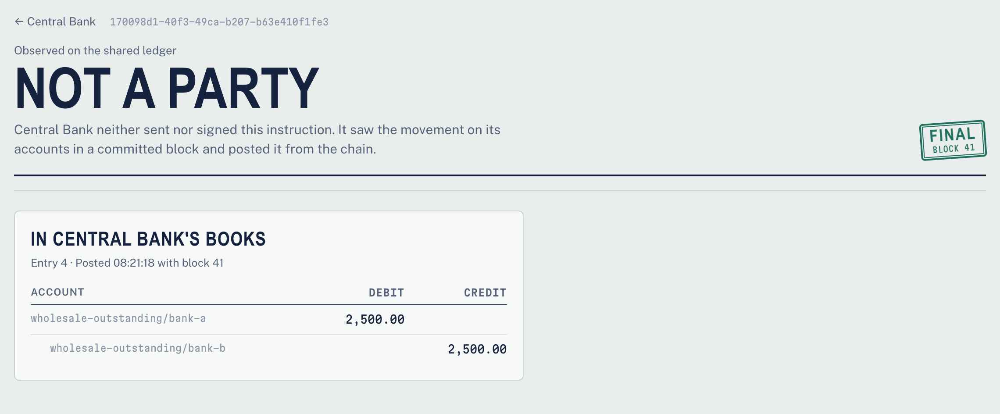

## 3. An approval, and a rejection

Above 10,000.00 CAD, Bank A's policy holds a payment until an approver
other than the operator who started it approves it. Until then nothing is
signed or sent, and the funds are held in Bank A's books.

```
§15  above 10000.00 CAD a payment at bank-a waits for 1 approval from approver
  12000.00 CAD: proposed by ops-1, funds held, nothing signed or sent; ops-1 cannot approve it (403); bank-b has not heard of it
  approved by approver-1, then co-signed by bank-b and final in block 46
  a second one rejected by approver-1: its pending entry voided, nothing sent
  ✓ 7.9s
```

The rejected payment is the run's first refusal. Its timeline shows the
approval rejected and the instruction never reaching the ledger. The legs it
would have settled are listed, and none moved.

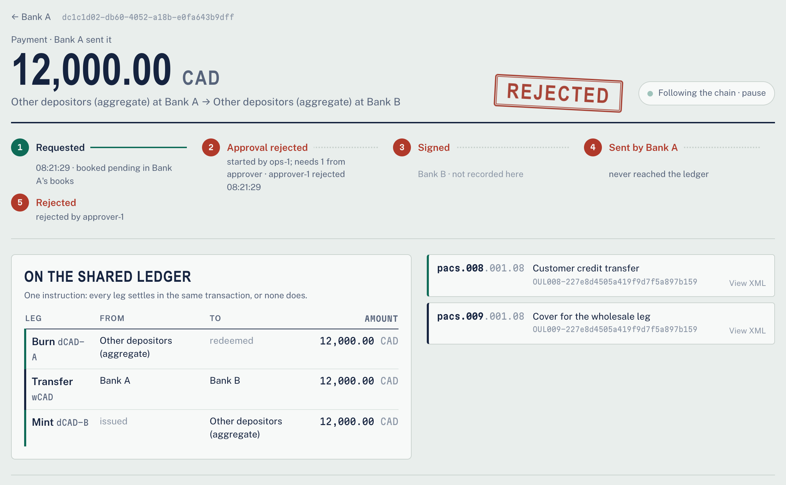

## 4. A bond, then a repo

Bank C, the bonds' agent, issues a bond to Banks A and B, each matched
against the buyer's affirmation, and Bank A sells part of its holding to
Bank B, delivery versus payment (§5.4, §5.5):

```
5.4  bank-c issues BOND-ISSUER-2031 to bank-a and bank-b, each matched against the buyer's affirmation
  issued 100000 units at 1000.00: 100000000.00 CAD paid to bank-c in block 54
  ✓ 14.0s

5.5  bank-a sells to bank-b, delivery versus payment
  7000 units at 1001.50: units and 7010500.00 CAD swapped in block 55
  ✓ 2.7s
```

Then Bank A lends Bank B 10,000,000.00 CAD for two weeks in a repo against
that bond. Each flow of the repo is one instruction through the same engine
(§5.7 to §5.10):

```
5.7  bank-a lends CAD to bank-b against BOND-ISSUER-2031: a repo both affirmed, opened in one instruction
  bank-b bought 20000 units of BOND-ISSUER-2029 at issue, the other bond the repo accepts
  bank-a affirmed the terms: 10300 units at 1000.00, 2% haircut, 10,000,000.00 CAD at 0.0275 from 2027-04-26 to 2027-05-10 (proposed)
  units B→A and cash A→B in block 62; repurchase price 10010547.95 CAD
  bank-a (lender): reverse-repos 10000000.00, collateral-received/BOND-ISSUER-2031 10300000.00, bond-holdings/BOND-ISSUER-2031 53000000.00
  bank-b (borrower): repo-borrowings 10000000.00, bond-holdings/BOND-ISSUER-2031 47000000.00, collateral-pledged/BOND-ISSUER-2031 10300000.00
  ✓ 14.2s

5.8  bank-a calls margin at an agreed mark; bank-b delivers it on the call
  at 990.00 on 2027-05-03 the collateral is short: bank-a calls 13 more units, due by 2026-10-19T12:26:59.000Z
  delivered in block 64: the call is met at both banks; collateral now 10313 BOND-ISSUER-2031
  ✓ 3.5s

5.10 bank-c pays a coupon on BOND-ISSUER-2031: bank-a received it on the collateral, and passes it on to bank-b
  coupon 1: bank-a paid on 63300 units, its own and the collateral, in block 66
  bank-a passed on 165999.32 CAD, the coupon on the collateral at the record block, in block 68
  ✓ 7.8s

5.9  bank-b substitutes BOND-ISSUER-2029 for BOND-ISSUER-2031 at marks both affirmed, in one instruction
  10313 BOND-ISSUER-2031 back to bank-b, 10462 BOND-ISSUER-2029 to bank-a, both in block 70
  ✓ 4.5s

5.10 bank-b closes the repo at its end date: every unit back, principal plus interest repaid
  repaid 10010547.95 CAD (interest 10547.95) in block 72; closed at both banks, no collateral left
  inv 14 at bank-a: 8 checks hold (record, books, margin cover, substitution value, close)
  inv 14 at bank-b: 8 checks hold (record, books, margin cover, substitution value, close)
  ✓ 4.1s
```

The interest is principal × rate × days / 365 (ACT/365F), rounded once:
10,000,000.00 × 0.0275 × 14 / 365 = 10,547.95.

The opening, seen at Bank B: Bank B sent the instruction once its approver
had approved it and Bank A had co-signed on the terms Bank A affirmed. Its
two legs, 10,300 bond units from Bank B to Bank A and
10,000,000.00 of wholesale money from Bank A to Bank B, settled together in
block 62.

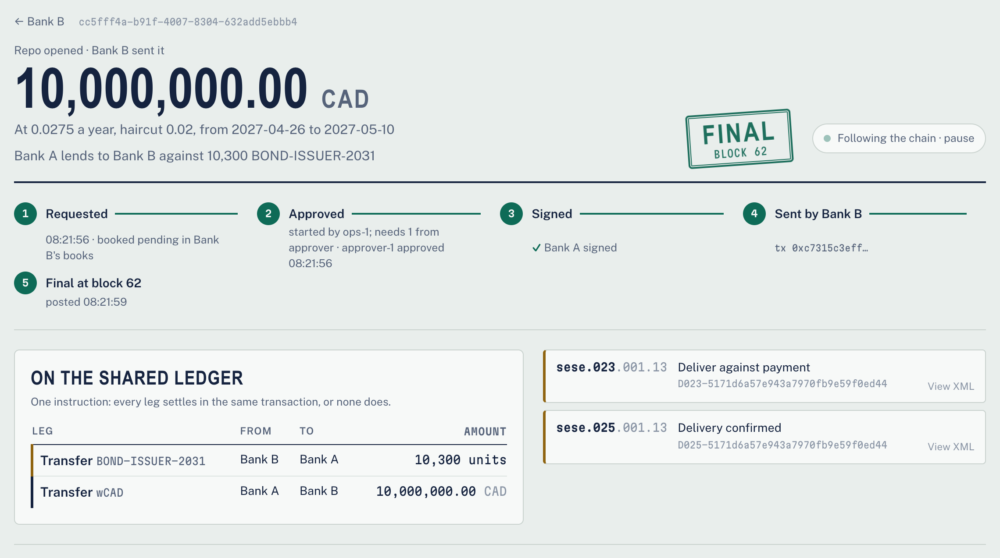

Each side sends a `sese.023` for each repo leg, with transaction type `REPU`
for the borrower's repo (`RVPO` for Bank A's reverse repo), and a `sese.025`
once it settles.

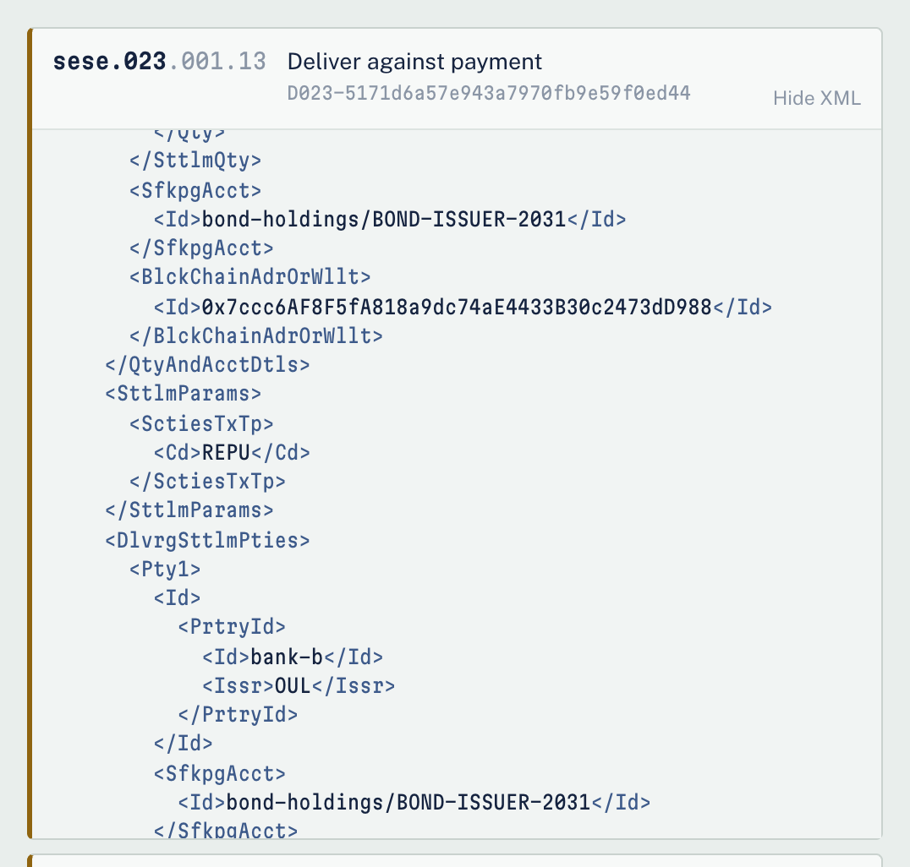

Neither bank books a sale. Bank B books the cash borrowed against
`repo-borrowings` and keeps the pledged units in its holdings, recording
them as pledged at face value (`collateral-pledged`, with
`collateral-to-recover` against it).

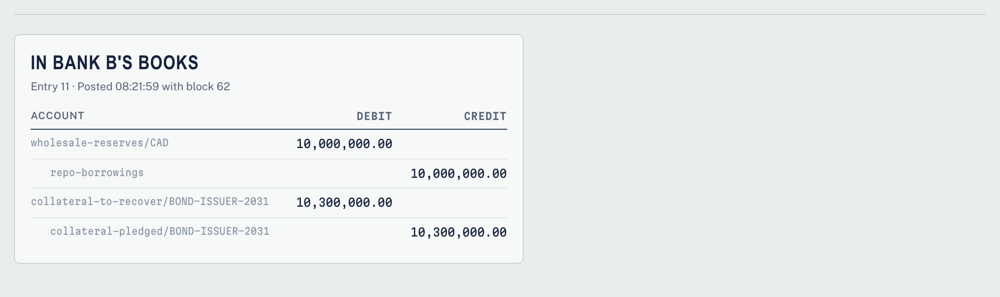

Bank A's view keeps each repo's terms, its collateral after each flow, the
margin call (called at marks as of 2027-05-03, met in block 64) and the
coupon it passed on to Bank B.

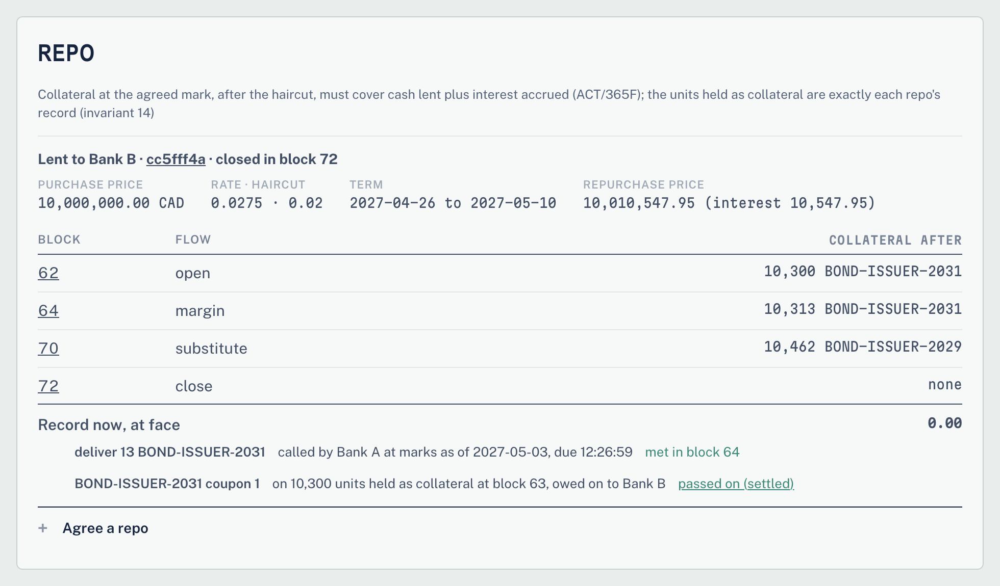

## 5. A refusal by the engine

The bond is an ERC-3643 token. It moves only inside a settlement, and only
to a holder whose identity carries a valid KYC claim. The Central Bank
revokes its claim on Bank B, then Bank A tries to sell Bank B ten units:

```
§15  BOND-ISSUER-2031 is an ERC-3643 token: a direct transfer is not compliant, and central-bank revoking bank-b's KYC claim stops bank-b receiving it
  bank-a transferring a unit directly: refused, TransferNotCompliant (only the settlement engine's movements are compliant)
  central-bank revoked its KYC claim on bank-b's identity in block 74: bank-b no longer verifies
  a trade of 10 units to bank-b: refused by the engine: ReceiverNotVerified; voided in both books
  bank-b keeps its 47000 units: it is still paid each coupon and redeemed below
  ✓ 7.1s
```

The settlement engine refused the trade when Bank A checked it before
sending, so no transaction was mined and both banks voided their entries.

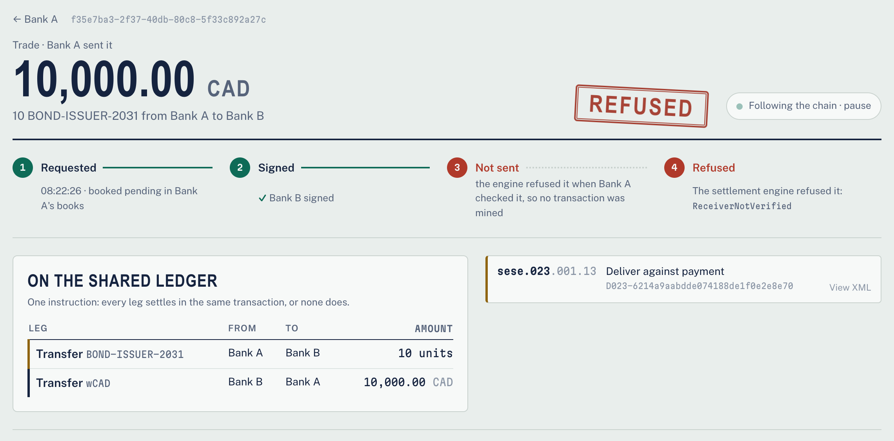

## 6. What every participant proves

The bond then pays its remaining coupons and is redeemed (§5.6), each
payment checked by every holder from the chain. The demo then reads each
participant's own check of its books against the chain. An excerpt, for
Bank A:

```
§6   invariants hold at every participant and across them
  bank-a         block 91: 2× inv 10, 2× inv 12, 8× inv 14, 1× inv 2, 2× inv 3, all hold
    inv 2  wholesale-reserves/CAD                    89624767.13 = 89624767.13
    inv 3  tokenized-deposits/other-depositors          15500.00 = 15500.00
    inv 3  tokenized-deposits                           15500.00 = 15500.00
    inv 12  policy: released only after the approvals it requires      13 released = 13 with their approvals
    inv 12  audit log: hash chain                      81 entries = verifies to ceffd82ee055
    inv 14  repo cc5fff4a margin at block 64: collateral after the haircut covers cash plus interest to 2027-05-03      10005273.97 = 10005672.60 (10313 BOND-ISSUER-2031)
    inv 14  repo cc5fff4a substitution at block 70: what came in is worth what went out  10121900.11 out = 10122037.31 in
    inv 14  repo cc5fff4a close at block 72: principal plus interest, every unit back      10010547.95 = 10010547.95 repaid, every unit returned
    inv 14  repo cc5fff4a (lender with bank-b): record             none = none moved by its instructions
  central-bank's line for bank-a = bank-a's wholesale reserves = 89624767.13 CAD
  central-bank's line for bank-b = bank-b's wholesale reserves = 73634136.99 CAD
  central-bank's line for bank-c = bank-c's wholesale reserves = 23741095.88 CAD
  ✓ 0.2s
```

The console shows the same check at the latest block, under Books against
the chain. The `inv` numbers are SPEC.md §6's invariants.

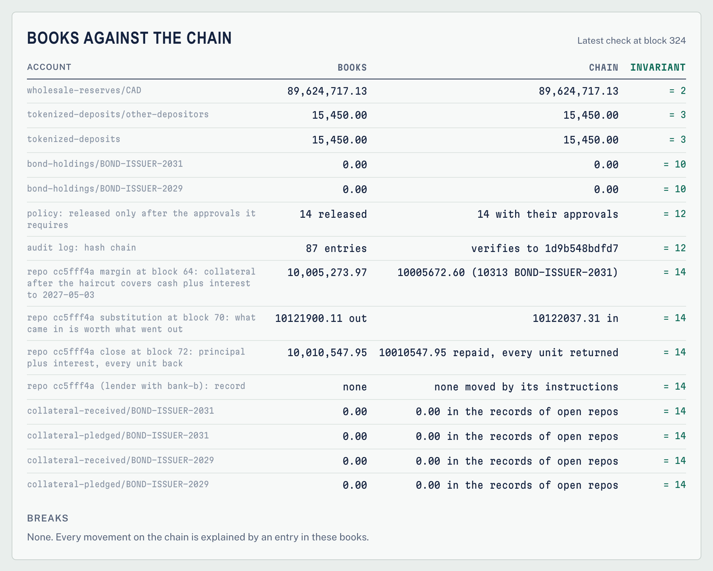

Every ISO 20022 message the services serve for the run validates against
the official XSDs:

```
§8   every participant's ISO 20022 messages validate against the official XSDs
  5.1 fund bank-a CAD    4× camt.054
  5.1 fund bank-b CAD    4× camt.054
  5.2 tokenize           2× camt.054
  5.3 payment            2× camt.054, 2× pacs.002, 2× pacs.008, 2× pacs.009
  §15 approved payment   2× camt.054, 2× pacs.002, 2× pacs.008, 2× pacs.009
  5.4 bond issue         1× camt.054, 4× sese.023, 4× sese.025
  5.5 bond trade         2× sese.023, 2× sese.025
  5.7 repo open          2× sese.023, 2× sese.025
  5.8 repo margin        2× sese.023, 2× sese.025
  5.10 manufactured      2× camt.054, 2× pacs.002, 2× pacs.009
  5.9 repo substitution  4× sese.023, 4× sese.025
  5.10 repo close        2× sese.023, 2× sese.025
  5.6 bond redemption    5× camt.054, 4× sese.023, 4× sese.025
  camt.053 from bank-a           /customers/other-depositors/statement: closing 15500.00 CAD
  camt.053 from central-bank     /banks/bank-a/statement: closing 89624767.13 CAD
  80 messages, every one valid
  ✓ 4.2s
```

## 7. The audit log

Each participant appends every initiation, approval, rejection, signature,
submission and outcome to its audit log, in the same database transaction
as the change, and each entry carries the hash of the one before. The demo
edits one entry to show the chain breaking there, then puts it back:

```
§15  every participant's audit log proves invariant 12, and its hash chain shows an edited entry
  central-bank     34 entries, chain verifies to 6d8def5fedae; 10 with their approvals
  bank-a           87 entries, chain verifies to 1d9b548bdfd7; 14 with their approvals
  bank-b           87 entries, chain verifies to 8b8d238ff73b; 15 with their approvals
  bank-c           63 entries, chain verifies to de5d5a8ac34d; 13 with their approvals
  29 approvals given in this run, each by an operator other than the initiator
  edited entry 19 (who approved): the chain breaks there, "its content does not match its hash"
  put back exactly as it was, it verifies again: the chain proves content, not who holds the database
  ✓ 0.2s
```

Bank A's log in the console, newest first, ending at the head the demo
printed (`1d9b548bdfd7`):

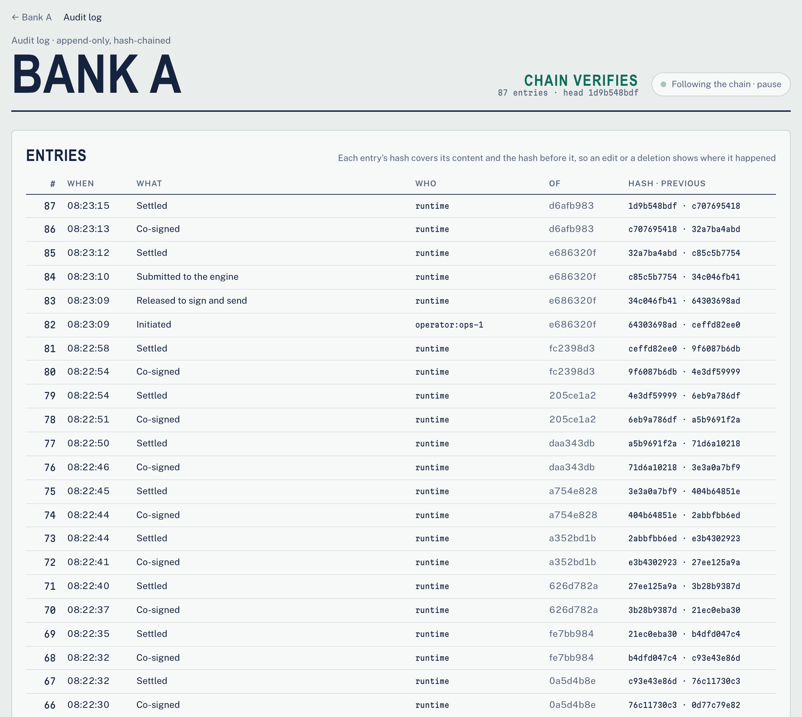

Further down is the rejected payment from section 3: initiated by `ops-1`,
rejected by `approver-1`, and nothing after it.

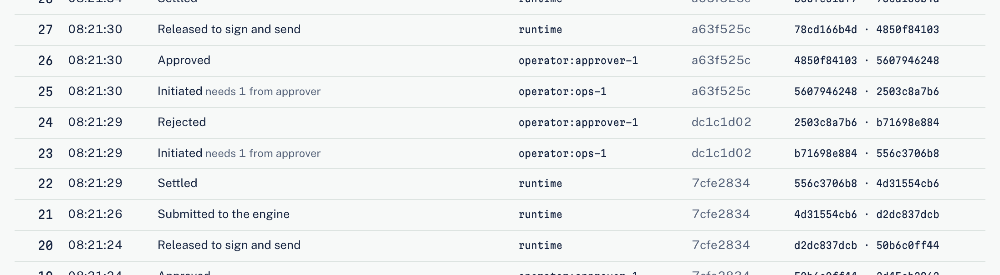

Before the audit step, Bank B moved to a new signing key in one registry
change, admitted by the Central Bank under both participants' policies.
Last, the demo writes a balanced but false entry into Bank A's journal, and
Bank A's own reconciler catches it at the next block:

```
§15  bank-b moves to a new signing key, admitted by central-bank under both policies, and settles with it
  admin-1 at bank-b asks for a new key: proposed
  central-bank allowlisted 0x071579aD… on 4 validators and rotated it in block 95, retiring 0x7ccc6AF8…
  bank-b co-signed a payment with key 2 (block 98) and sent one (block 100); its balances never left its address
  ✓ 12.8s

§6   a corrupted entry in bank-a's books shows up as a break
  wrote a balanced but false entry to bank-a's journal at block 100
  break at block 101: tokenized-deposits/other-depositors books 15449.00, chain 15450.00
  break at block 101: tokenized-deposits books 15449.00, chain 15450.00
  corrected by a reversing entry at block 101; reconciles again at block 102
  blocks 101–101 stay recorded as broken in bank-a's reconciliation history
  ✓ 4.4s

End to end: every flow settled, every participant reconciled, the corruption was caught.

Demo finished in 226s: every flow settled, every participant reconciled, every message valid.

Explore ca-repo
  console       http://localhost:7090/p/central-bank
  Central Bank  http://127.0.0.1:7100
  Bank A        http://127.0.0.1:7101
  Bank B        http://127.0.0.1:7102
  Bank C        http://127.0.0.1:7103
```

## 8. The harness

The simulation harness drives seeded random flows and injected faults
through the same services, and checks every invariant at every block from
outside them, reading each participant's books from Postgres and the chain
from a node. In serve mode it takes work from the console:

```bash
pnpm sim ca-repo --serve --seed 16
pnpm console
```

After the harness's prelude (funding, and both bonds issued), a
frozen-counterparty fault injected from the Harness page was skipped, since
no customer held tokens yet. Ten seeded flows followed, with faults mixed in
at one in four: two repos opened, funding, tokenizing and payments, a
validator stopped and restarted, a participant left behind twice and caught
up, a frozen counterparty, and a payment for more than the payer held,
refused by its bank. Every invariant held at every one of 97 blocks, 1,470
checks in all.


The whole-run checks run on demand: each instruction settled exactly once,
every refused one voided with nothing on chain, deposits moved only by
payments, every holder eligible, every repo replayed from the chain, and
every audit log verified against its policy.

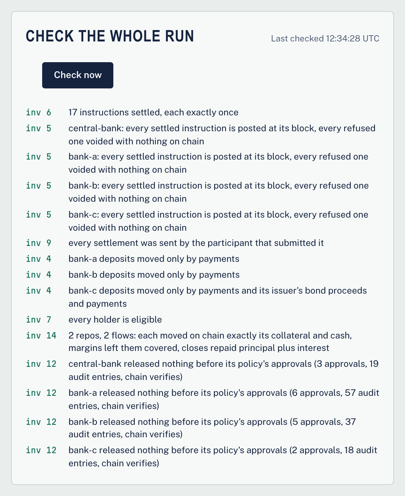

The frozen-counterparty fault shows the second kind of refusal. Bank A froze
its customer's tokens on chain, behind its own books, and the customer then
paid. The engine refused the payment (`ERC20InsufficientUnfrozenBalance`),
Bank A voided its entry, and the `pacs.002` reports the rejection, `RJCT`,
with the engine's reason.

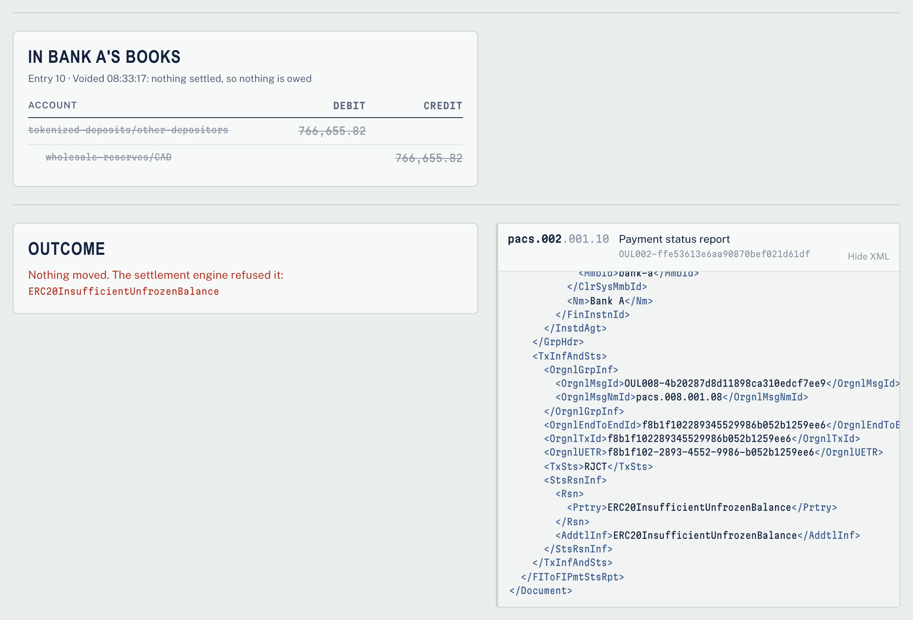

## 9. Two ledgers, and who sees what

Two more pages show the runs behind the README's [Results](../README.md#results).
The Interop page reads what `pnpm interop ca-interbank` saved: the same
payment with Bank B's deposit token on a second Besu network, under each
coordinator and each fault.

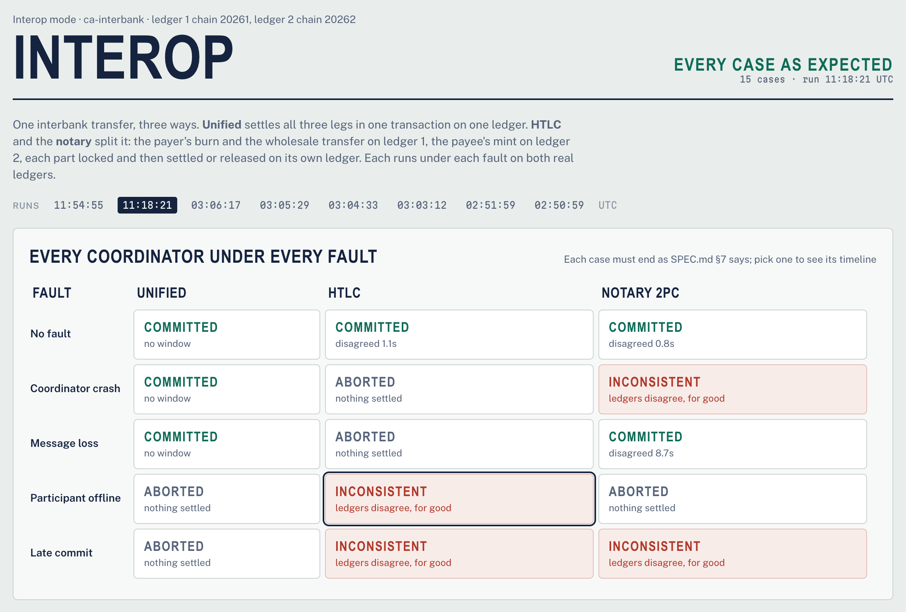

Each case opens to its timeline. With HTLC and Bank B offline, the payee was
credited on ledger 2 at 4.8 s, Bank B came back after ledger 1's timeout and
its claim was refused, and Bank A was refunded on ledger 1. The two ledgers
disagree for good.

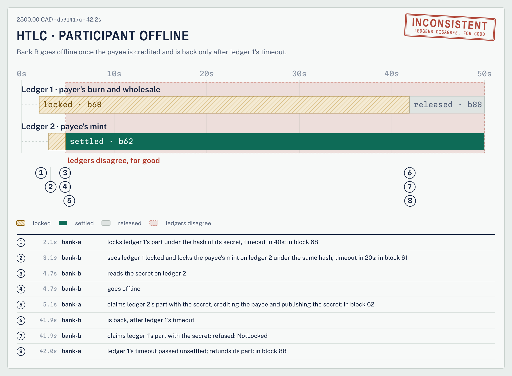

The Who sees what page reads what `pnpm confidential:compare ca-interbank`
measured, with a Paladin node per bank. In confidential mode the validators
and the Central Bank see the amount of the wholesale leg and nothing of the
customers, and each bank sees only its own customer.

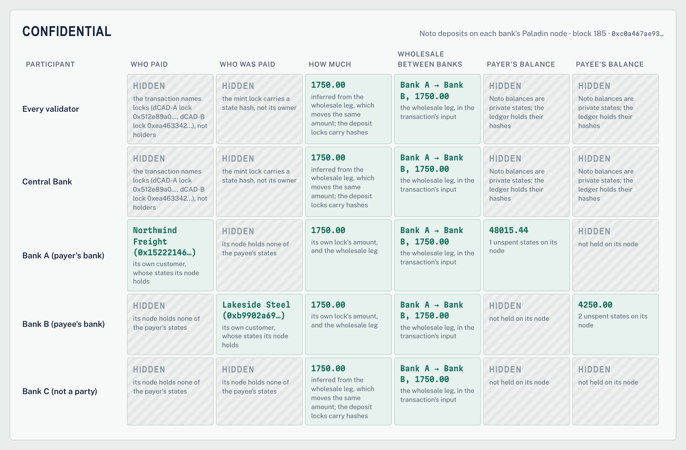

## What this run does not show

It is one run of one scenario, on one machine. The seeded runs, the
conformance kit and the interop cases, with the commands that reproduce
them, are in the README's [Results](../README.md#results). What the sandbox
leaves open is in [design.md §4](design.md#4-what-the-sandbox-leaves-open).
